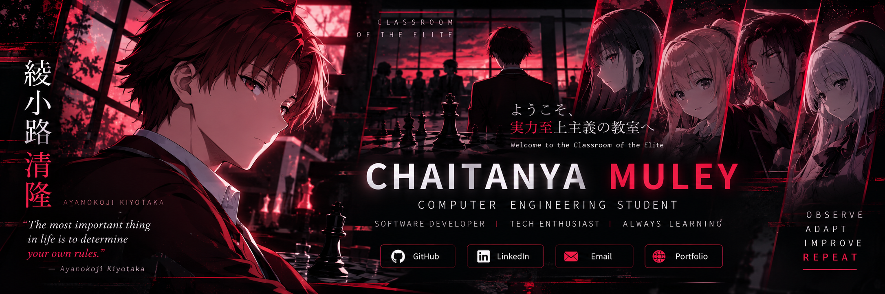
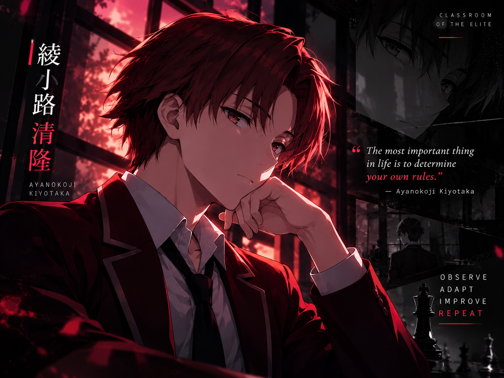
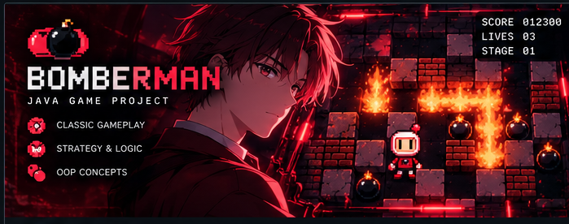
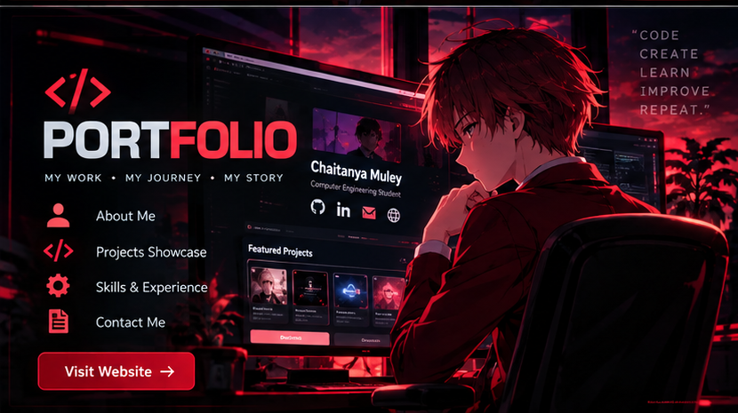
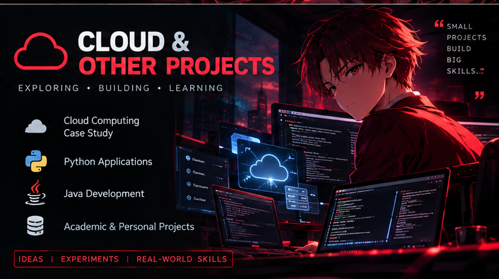

 

# CHAITANYA MULEY

### `COMPUTER ENGINEERING STUDENT` • `DEVELOPER IN TRAINING`

**"Observe. Learn. Build. Improve."**

---

## `01` — ABOUT ME

Hi! I'm **Chaitanya Muley**, a Diploma Computer Engineering student at Government Polytechnic Pune.

- 💻 Interested in software and full-stack development.
- 🌱 Learning by building practical projects.
- 🧠 Exploring Android development, cloud computing, and AI/ML.
- 🎯 Working toward a software development internship.
- ⚡ I enjoy games, technology, and learning new things.

 

---

## `02` — TECH ARSENAL

---

## `03` — FEATURED PROJECTS

<table>
<tr>
<td width="50%" valign="top">

### 🎮 Bomberman

A Java game project demonstrating object-oriented programming and game development concepts.

- Player movement and game logic
- Game objects and collision handling
- Java programming practice

**Tech Stack:** Java • OOP

</td>
<td width="50%" valign="top">

### 🎯 CareerNest

An Android career guidance application designed to help students explore career opportunities and plan their learning journey.

- Career exploration and details
- Career roadmaps and learning goals
- Career quizzes and saved careers
- Dark mode support

**Tech Stack:** Java • Android Studio

</td>
</tr>

<tr>
<td width="50%" valign="top">

### 🌐 Developer Portfolio

My personal portfolio website showcasing my projects, technical skills, and development journey.

- Responsive portfolio design
- Project showcase
- Personal developer profile

**Tech Stack:** React • TypeScript • Vite • Tailwind CSS

</td>
<td width="50%" valign="top">

### ☁️ Cloud Computing Case Study

A Cosmos Bank case study exploring cloud computing concepts and cybersecurity considerations in the banking sector.

- Cloud computing concepts
- Cyberattack analysis
- Cloud security considerations

**Tech Stack:** Cloud Computing • Cybersecurity

</td>
</tr>
</table>

---

## `04` — GITHUB STATISTICS

 

### CONTRIBUTION ACTIVITY

---

## `05` — CONNECT

**Learning every day. Building one project at a time.**

Inspired by Classroom of the Elite • Designed with a crimson aesthetic

