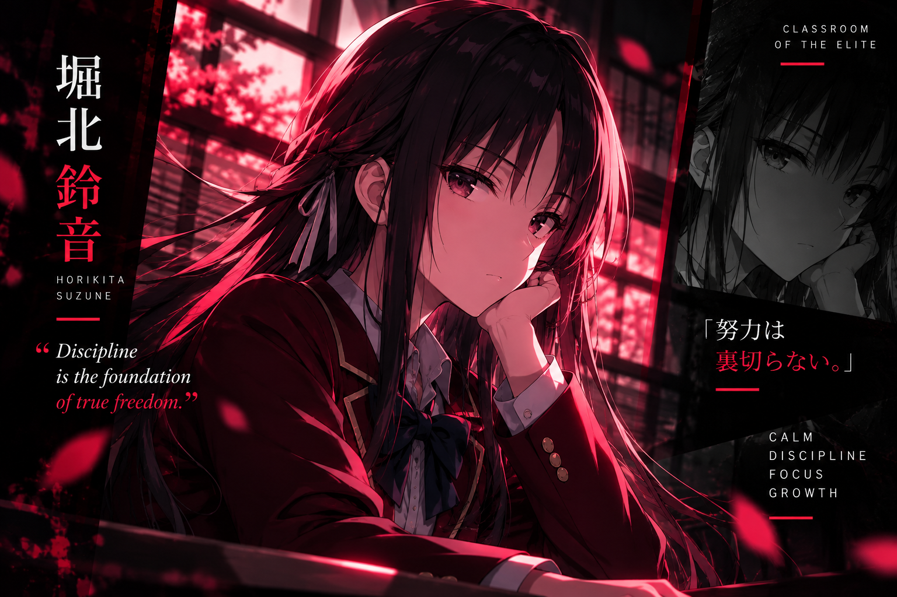
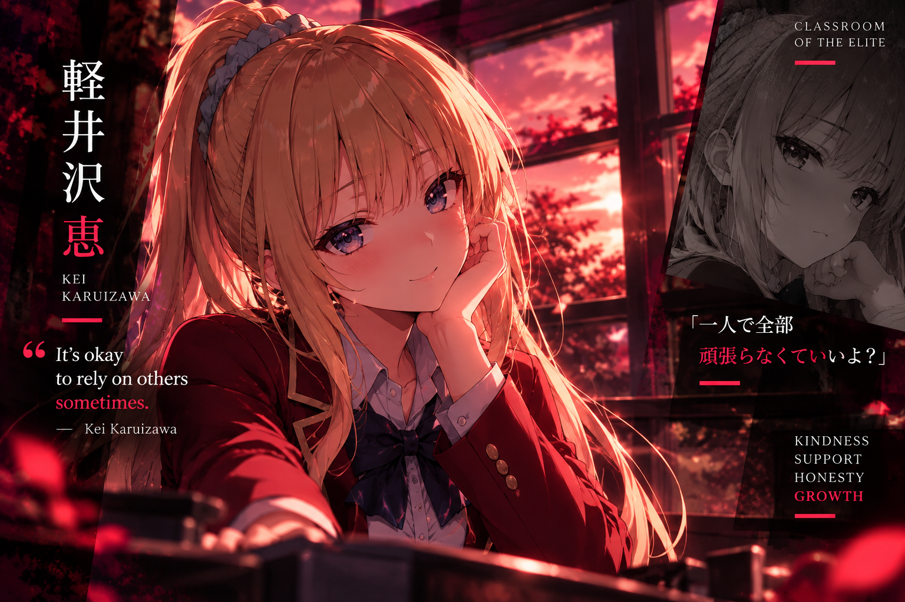

  

  # CHAITANYA MULEY
  ### `COMPUTER ENGINEERING STUDENT` • `DEVELOPER IN TRAINING`

  **"Observe. Learn. Build. Improve."**

  
  

---

## `01` — ABOUT ME

Hi! I'm **Chaitanya Muley**, a Diploma Computer Engineering student at Government Polytechnic Pune.

- 💻 Interested in software and full-stack development.
- 🌱 Learning by building practical projects.
- 🧠 Exploring Android, cloud computing, and AI/ML.
- 🎯 Working toward a software development internship.
- ⚡ I enjoy games, technology, and learning new things.

 

---

## `02` — TECH ARSENAL

---

## `03` — FEATURED PROJECTS

<table>
<tr>
<td width="50%" valign="top">

### 🚗 NeuroDrive

Driver drowsiness detection and fleet safety monitoring.

- Camera-based driver monitoring
- Blink and yawn analysis
- Safety alerts and trip history

**Focus:** Android • Java • ML Kit • IoT

</td>
<td width="50%" valign="top">

### 🎯 CareerNest

An Android career guidance application for students.

- Career exploration
- Learning roadmaps
- Career quizzes and saved careers

**Focus:** Java • Android Studio

</td>
</tr>
<tr>
<td width="50%" valign="top">

### 🌐 Developer Portfolio

My personal website showcasing my development journey and work.

**Focus:** React • TypeScript • Vite • Tailwind CSS

[Visit Portfolio →](https://chaitanya-720.github.io/)

</td>
<td width="50%" valign="top">

### ☁️ Cloud & Other Projects

Exploring cloud computing, Python applications, and Java development through academic and personal projects.

**Focus:** Python • Java • Cloud Computing

[Explore Repositories →](https://github.com/chaitanya-720?tab=repositories)

</td>
</tr>
</table>

---

## `04` — GITHUB STATISTICS

### CONTRIBUTION ACTIVITY

---

## `05` — CLASSROOM OF THE ELITE

*Strategy. Intelligence. Discipline.*

<table>
<tr>
<td align="center" width="50%">

 <b>HORIKITA SUZUNE</b>
 Discipline • Determination
</td>
<td align="center" width="50%">

 <b>KEI KARUIZAWA</b>
 Trust • Growth
</td>
</tr>
<tr>
<td align="center" width="50%">

 <b>RYUEN KAKERU</b>
 Strategy • Fearlessness
</td>
<td align="center" width="50%">

 <b>SAKAYANAGI ARISU</b>
 Intelligence • Precision
</td>
</tr>
</table>

---

## `06` — CONNECT

**Learning every day. Building one project at a time.**

Inspired by Classroom of the Elite • Designed with a crimson aesthetic

